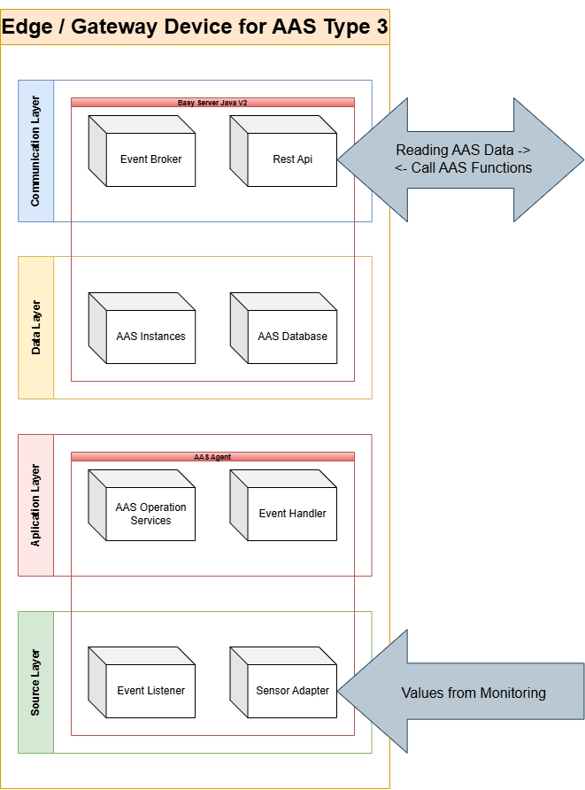
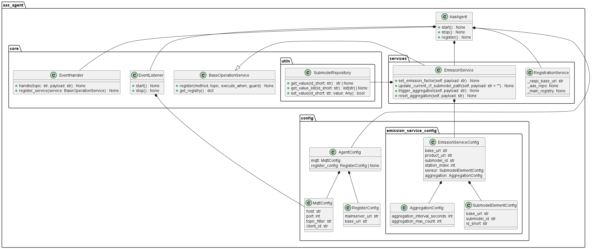

# AAS Agent

The AAS Agent is an event-driven runtime component that extends a static Asset Administration Shell (AAS), such as an Eclipse BaSyx server, with dynamic behavior.

**Already available:**
- AAS Type 1 functionality (static data representation) with [Eclipse BaSyx™](https://basyx.org/) ([BaSyx Java Version 2](https://wiki.basyx.org/en/latest/content/user_documentation/basyx_components/v2/index.html) or [BaSyx Go](https://github.com/eclipse-basyx/basyx-go-components))

**It enables:**
- AAS Type 2 functionality (live data integration) by reacting to incoming data streams (e.g. via AAS, fieldbuses or directly connected sensors)
- AAS Type 3 functionality (active operations) by executing domain-specific actions based on AAS state changes

The agent continuously monitors AAS-related events and maps them to executable operations.

---

## Why use an AAS Agent?

While platforms like [Eclipse BaSyx™](https://basyx.org/) provide a solid foundation for managing AAS data (Type 1), they do not natively support reactive or autonomous behavior.

The AAS Agent is an exemplary implementation to close this gap through the introduction of:

- Reactive processing of AAS changes
- Automated execution of operational routines

This turns a passive digital model (Type 1) not only into a digital shadow (Type 2) but into an active digital twin (Type 3).

---

## Software Architecture

<p align="center">
  
</p>

---

## Class Diagram

<p align="center">
  
</p>

---

## Installation and Usage

### Prerequisites

- A running AAS server (e.g. [Eclipse BaSyx](https://basyx.org/))

---

### 1. Install `uv`

Follow the official installation guide: [docs.astral.sh/uv/getting-started/installation](https://docs.astral.sh/uv/getting-started/installation/)

**Linux:**
```bash
curl -LsSf https://astral.sh/uv/install.sh | sh
```

Verify your installation:
```bash
uv --version
# Expected output: uv 0.10.8 or similar
```

> **Note:** Make sure the `uv` binary is available in your `PATH`.

---

### 2. Clone the Repository

**Using Git:**
```bash
git clone https://github.com/Crauder00/Aas_Agent.git
cd AAS_AGENT
```

**Linux (without Git, via release archive):**
```bash
mkdir AAS_AGENT && cd AAS_AGENT
curl -L -O https://github.com/Crauder00/Aas_Agent/releases/download/<version>/<release-file>.zip
unzip <release-file>.zip
```
> **Note:** Replace `<version>` and `<release-file>` with the actual values from the [Releases page](https://github.com/Crauder00/Aas_Agent/releases).

---

### 3. Install Dependencies

Inside the `AAS_AGENT` folder, run:

```bash
uv sync --no-dev
```

---

### 4. Configure the Agent

Open `main.py` and adjust the configuration to your environment, or integrate the configuration block into your own application.

All available configuration options are located in:
AAS_AGENT/aas_agent/config/
> **Note:** You do not need to modify the config files directly — all options can be set via `main.py`.

---

### Configuring MQTT or polling

Create the service instances first, then bind their registered operation paths to
an explicit repository and submodel using `watches`:

```python
from aas_agent import (
    AasAgent, AgentConfig, EmissionService, ListenerConfig, SubmodelWatch,
)

# Define emission_config_station_0 and emission_config_station_1 as in main.py.
services = [
    EmissionService(emission_config_station_0),
    EmissionService(emission_config_station_1),
]

agent_config = AgentConfig(
    listener=ListenerConfig(
        mode="mqtt",
        host=MQTT_HOST,
        watches=[
            SubmodelWatch(
                base_url=LOCAL_AAS,
                submodel_id=CF_SUBMODEL_ID,
                services=services,
            ),
        ],
    ),
)
agent = AasAgent(agent_config, services)
agent.start()
# Keep the application running, then call agent.stop() on shutdown.
```

- `base_url` is the REST repository URL accessible from the agent.
- `submodel_id` is the plain submodel ID, not Base64 encoded.
- `services` contains the same instances passed to `AasAgent`. Their registered
  paths determine which values are watched; submodels are not inferred from services.
- Add another `SubmodelWatch` for each additional repository/submodel. Group services
  watching the same repository/submodel in a single watch.
- Optional `event_source` matches the CloudEvent `source` exactly when multiple
  repositories publish the same submodel ID. REST requests still use `base_url`.

The default MQTT filter is `basyx/submodelrepository/submodel/updated` for BaSyx Go.
On a matching `io.admin-shell.submodel.updated.v1` CloudEvent, the handler reads
registered values via REST and dispatches only detected changes. For BaSyx Java,
set `topic_filter="sm-repository/+/submodels/+/submodelElements/+/updated"`.
A list of filters can subscribe to both formats.

For polling, replace the listener configuration with:

```python
ListenerConfig(
    mode="polling",
    poll_interval_seconds=1.0,
    watches=[SubmodelWatch(LOCAL_AAS, CF_SUBMODEL_ID, services)],
)
```

Polling opens no MQTT connection. In `main.py`, set `EVENT_MODE = "polling"`
and adjust `POLL_INTERVAL_SECONDS`; the interval is used only for polling.
Both modes establish an initial baseline without triggering operations, then
apply the existing `execute_when` conditions and guards to value changes.
The old `AgentConfig(mqtt=MqttConfig(...))` configuration remains supported for
Java MQTT without watches. If `listener` is supplied, it takes precedence.

---

### 5. Prepare Your AAS Server

Make sure your AAS server is running before starting the agent (e.g. Eclipse BaSyx Java V2 or BaSyx Go).

Then upload the initial asset to your server — choose one of the following approaches:

**Upload via `.aasx` file:**
Use your AAS server's UI or API to upload the provided `ES_V3.aasx` package directly.

---

### 6. Start the Agent

#### Manually (Windows)

```bash
.venv\Scripts\activate.bat
python main.py
```

#### Manually (Linux / macOS)

```bash
source .venv/bin/activate
python main.py
```

#### Automatically on Linux via systemd

Create a new service file:

```bash
sudo nano /etc/systemd/system/aas-agent.service
```

Paste the following content and adjust the paths to match your setup:

```ini
[Unit]
Description=AAS Agent
After=network.target

[Service]
Type=simple
User=<your-user>
WorkingDirectory=/home/<your-user>/AAS_AGENT
ExecStart=/home/<your-user>/.local/bin/uv run --no-dev python main.py
Restart=on-failure
RestartSec=5
StandardOutput=journal
StandardError=journal
Environment=PYTHONUNBUFFERED=1

[Install]
WantedBy=multi-user.target
```

> **Note:** Replace all occurrences of `<your-user>` with your actual Linux username (e.g. `pi`).

Enable and start the service:

```bash
sudo systemctl daemon-reload
sudo systemctl enable aas-agent.service
sudo systemctl start aas-agent.service
```

Check the status or logs:

```bash
sudo systemctl status aas-agent.service
sudo journalctl -u aas-agent.service -f
```
> **Note:** On first startup, `uv` may need to compile native dependencies from source (e.g. on ARM devices). This can take anywhere from a few seconds up to 30 minutes depending on your hardware.

---

## Extending with Custom Use Cases

Additional use cases can be added under `aas_agent/services/` as Python modules.

> **Important:** Every custom service **must** inherit from `aas_agent/core/base_operation_service.py` to ensure compatibility with the agent's execution lifecycle.

```
aas_agent/
└── services/
    ├── emission_service/ 
    ├── your_custom_service/
    │   ├── utils_for_custom_service.py
    │   └── your_custom_service.py   ← inherits from BaseOperationService
    └── ...
```

Once your service is implemented, register it in `main.py` by adding it to the `services` list and passing it to the agent:

```python
def main() -> None:
    ...

    services = [
        EmissionService(emission_config_station_0),
        EmissionService(emission_config_station_1),
        YourCustomService(your_config_0)  # Add more services if needed
    ]

    ...

    agent = AasAgent(agent_config, services)

    ...
```

---

## Known Limitations

- **`registration_service`** is currently under development and not yet tested.
- **BaSyx Go adaptation is under development.** CloudEvent MQTT handling and
  configurable polling are implemented, but live integration with BaSyx Go still
  needs validation. REST endpoints and MQTT settings must match your deployment.
- Reconciliation observes current values, not a complete event history. Rapid
  changes between reads and repeated writes of the same value can be missed.
  This limitation is accepted for the current prototype.
